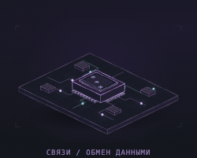
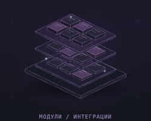
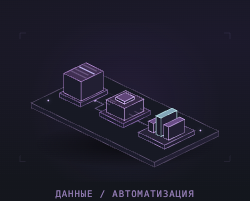
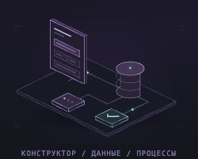
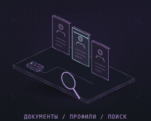

<a href="https://nunuga.github.io/Nunuga/?lang=en">English</a>

**Информационные системы для госсектора** 
Аналитика и автоматизация отчётности

[Полный профиль](https://nunuga.github.io/Nunuga/) · [Telegram](https://t.me/Kovtun_Kirill) · [Email](mailto:kirikov_08@mail.ru)

## Навыки и технологии

<b>Разработка</b>

<b>Аналитика и процессы</b>

<b>Дизайн и визуализация</b>

## Проекты и опыт

<b>АИС для федеральных ведомств</b>

**Руководитель управления IT-аналитики** 
Госсектор / Информационные системы

Руководил командой при проектировании и запуске АИС для федеральных органов исполнительной власти. В состав работ входили backend, frontend и UX/UI.

- **Руководство командой.** Руководил командой при проектировании и запуске системы.
- **Проектирование и UX/UI.** Работал над проектированием системы и пользовательских интерфейсов.
- **Разработка и запуск АИС.** Работа над backend и frontend, участие в запуске АИС.

[Регистрация программы для ЭВМ № 2024663474](https://www1.fips.ru/fips_servl/fips_servlet?DB=EVM&DocNumber=2024663474&TypeFile=html)

[Подробнее о проекте](https://nunuga.github.io/Nunuga/#evolution-case-01)

 

<b>Информационная система для Минстроя России</b>

**Руководитель управления IT-аналитики** 
Цифровые сервисы / Интеграции

Развивал АИС для Минстроя России: модули системы, интеграции и мобильное приложение.

- **Развитие модулей системы.** Вёл IT-аналитику при развитии функциональных модулей системы.
- **Интеграционная часть АИС.** Работал над интеграционной частью АИС для Минстроя России.
- **Мобильное приложение.** Участвовал в работе над мобильным приложением АИС.

[Регистрация программы для ЭВМ № 2024665653](https://www1.fips.ru/fips_servl/fips_servlet?DB=EVM&DocNumber=2024665653&TypeFile=html)

[Подробнее о проекте](https://nunuga.github.io/Nunuga/#evolution-case-02)

 

<b>Дашборды, Telegram-боты и отчётность</b>

**Руководитель проектов** 
Данные / Автоматизация

Руководил проектами дашбордов и Telegram-ботов, занимался автоматизацией отчётности.

- **Аналитические дашборды.** Руководил проектами аналитических дашбордов на Power BI.
- **Автоматизация отчётности.** Автоматизация отчётности с помощью Google Apps Script.
- **Telegram-боты.** Руководил проектами Telegram-ботов на базе Telegram API.

Ранее · МинЖКХ Московской области. Внедрение и поддержка цифровой инфраструктуры, аналитика и работа с пользователями.

[Подробнее о проекте](https://nunuga.github.io/Nunuga/#evolution-case-03)

 

<b>Платформа-конструктор для работы с данными</b>

**Соавтор программы** 
Собственный продукт / I8U8

Платформа для настройки форм, хранения данных и согласования записей по заданным маршрутам.

- **Настройка форм и схем данных.** Создание электронных форм, настройка схем данных и построение произвольных иерархий.
- **Сбор, проверка и хранение.** Сбор, проверка и хранение записей. Настройка уровней ввода, учётных записей, ролей и прав доступа.
- **Назначение и согласование.** Маршруты назначения и согласования, статусы записей. Доступны интерфейсы пользователя и администратора.

Включена в реестр российского ПО Минцифры России.

[Регистрация программы для ЭВМ № 2026668717](https://www1.fips.ru/fips_servl/fips_servlet?DB=EVM&DocNumber=2026668717&TypeFile=html)

Правообладатель — ООО «И8У8».

[Подробнее о проекте](https://nunuga.github.io/Nunuga/#evolution-case-04)

 

<b>КАДР — система работы с резюме</b>

**Мой проект** 
Собственный проект / HR-tech

Загрузка документов, извлечение данных, ручная проверка и поиск по единому реестру кандидатов.

- **Извлечение и проверка данных.** Загрузка PDF, DOCX, DOC и RTF. Локальное извлечение текста, OCR сканов и разбор резюме с помощью ИИ. Карточку можно проверить и исправить рядом с оригиналом.
- **Единый реестр кандидатов.** Поиск по сферам и специализациям, актуальные и архивные резюме, история поступлений и версии документов. Выгрузки в Excel, PDF и Word.
- **Документы с телефона.** Передача файлов через системное меню «Поделиться», фоновая очередь загрузки и встроенный кабинет для просмотра и редактирования. Отправка возобновляется после восстановления сети.

**Стек:** Node.js, Express, PostgreSQL, Java / Android. 
[кадр.su](https://кадр.su)

[Подробнее о проекте](https://nunuga.github.io/Nunuga/#evolution-case-05)

 

## I8U8

Моя компания. Разработка информационных систем, автоматизация и решения с искусственным интеллектом.
